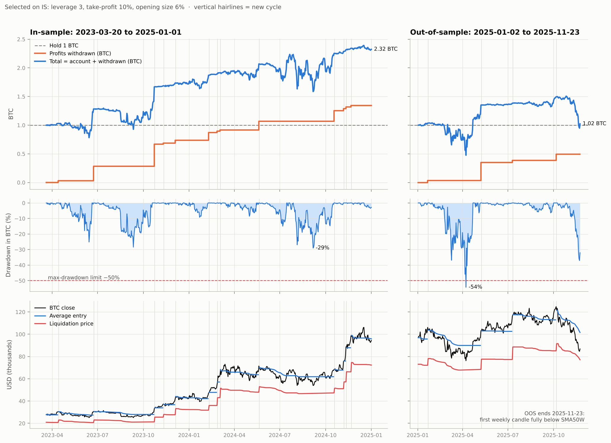
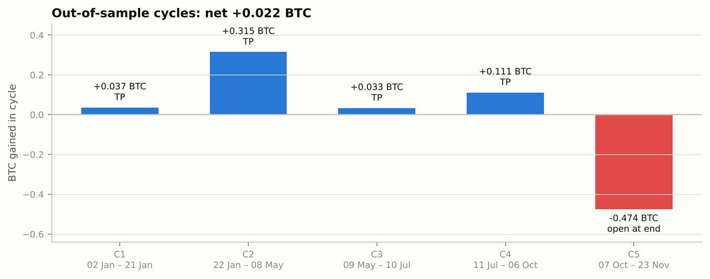
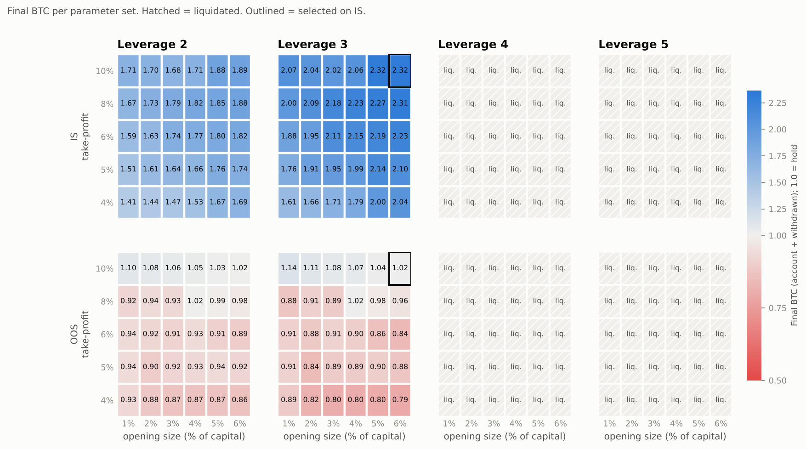

# BTC Coin-M DCA Ladder: Backtest and Out-of-Sample Validation

A deterministic backtester for a DCA ladder on coin-margined (inverse) BTC perpetual futures, with explicit contract mechanics: inverse PnL in BTC, funding, commission, slippage and isolated-margin liquidation. The strategy's objective is to **accumulate BTC**, so equity, drawdown and parameter selection are all measured in BTC.

**Main result.** Parameters selected in-sample (2023–2024 bull market) turned 1 BTC into 2.32 BTC. Out of sample (2025, up to the bear-market signal) the same parameters ended at 1.02 BTC, which is effectively the same as holding, with a 54% drawdown in BTC. That drawdown breaches the 50% limit used for selection. The in-sample edge was mostly leveraged exposure to a rising market.



## Strategy

- **Capital:** 1 BTC. It is the only collateral and the only source of ladder buys. No external capital is ever added.
- **Entry:** open a long with `open_margin_pct` of capital as isolated margin, at leverage `leverage_limit`.
- **Ladder:** on every day the close is below the average entry, add 1–5% of capital as margin at the same leverage. The size grows with the distance below the entry. Below −30%, an extra 5–10% is added as margin without notional, which pushes the liquidation price down. Adds are capped at the free margin; once it is used up, the ladder stops buying.
- **Exit:** take-profit at `take_profit_pct` above the average entry. Profit above 1 BTC is **withdrawn** from the account and is not reused as margin or capital. The next cycle starts again with 1 BTC.
- **Funding:** 10% p.a. on notional, charged daily. It is paid from free margin first, and from position margin only once free margin is exhausted.
- **Liquidation (isolated):** the position margin is lost, undeployed free margin survives, and no new cycles open in that window.

## Data and windows

- **Data:** BTC-USD daily OHLC from Yahoo Finance, 2015-10-24 → 2026-11-07, daily bars closing 00:00 UTC.
- **Costs:** 4 bps commission per side, 0.5 bps slippage, 0.5% maintenance margin.
- **In-sample (IS):** 2023-03-20 → 2025-01-01. It starts at the first weekly close above both the weekly SMA50 and SMA200.
- **Out-of-sample (OOS):** 2025-01-02 → 2025-11-23. The end date is computed, not chosen: it is the close of the first weekly candle that opens and closes below the weekly SMA50 (open 94,181, close 86,805, SMA50W 102,660).
- **Grid, run on IS only:** leverage {2, 3, 4, 5} × take-profit {4, 5, 6, 8, 10%} × opening size {1–6%} = 120 combinations.
- **Selection rule, fixed before looking at OOS:** not liquidated, max drawdown in BTC ≥ −50%, then maximum final BTC (account + withdrawn).
- **OOS application:** the selected parameters are applied to OOS unchanged.

## Results

Selected parameters: leverage 3, take-profit 10%, opening size 6%.

| | IS strategy | IS hold 1 BTC | OOS strategy | OOS hold 1 BTC |
|---|---|---|---|---|
| Final BTC (account + withdrawn) | **2.32** (0.98 + 1.34) | 1.00 | **1.02** (0.53 + 0.50) | 1.00 |
| Max drawdown in BTC | −29% | 0% | **−54%** | 0% |
| CAGR (USD) | 218% | 98% | −9% | −12% |
| Sharpe (daily, USD) | 1.68 | 1.67 | 0.58 | −0.08 |
| Max drawdown (USD) | −44% | −26% | −67% | −32% |
| Expected shortfall 95%, daily (USD) | −9.9% | −5.2% | −15.7% | −5.0% |

### Out-of-sample cycles



| Cycle | Dates (2025) | Exit | Price start → end | Low | Ladder buys | Max notional | Min free margin | Liquidation price start → min | BTC gained |
|---|---|---|---|---|---|---|---|---|---|
| 1 | 02 Jan → 21 Jan | Take-profit | 96,892 → 106,141 | 89,260 | 6 | $37k | 0.868 | 73,032 → 72,132 | +0.037 |
| 2 | 22 Jan → 08 May | Take-profit | 103,658 → 103,236 | 74,437 | 58 | $263k | **0.000** | 78,132 → 67,804 | +0.315 |
| 3 | 09 May → 10 Jul | Take-profit | 102,976 → 115,981 | 98,286 | 4 | $34k | 0.885 | 77,618 → 77,327 | +0.033 |
| 4 | 11 Jul → 06 Oct | Take-profit | 117,523 → 124,746 | 107,271 | 37 | $156k | 0.522 | 88,583 → 85,127 | +0.111 |
| 5 | 07 Oct → 23 Nov | Open at window end | 121,457 → 86,801 | 80,660 | 42 | $271k | 0.093 | 91,549 → 77,120 | **−0.474** |

Cycles 1–4 added +0.50 BTC. Cycle 5 opened one day after the cycle top and kept buying all the way down, giving almost all of it back.

### Full grid, in-sample vs out-of-sample



| Leverage | IS liquidated | IS median BTC | OOS liquidated | OOS within −50% DD | OOS above 1 BTC | OOS median BTC |
|---|---|---|---|---|---|---|
| 2 | 0 of 30 | 1.70 | 0 of 30 | 30 of 30 | 7 of 30 | 0.93 |
| 3 | 0 of 30 | 2.05 | 0 of 30 | 1 of 30 | 7 of 30 | 0.90 |
| 4 | 30 of 30 | 1.89 | 30 of 30 | 0 of 30 | 0 of 30 | 0.69 |
| 5 | 30 of 30 | 1.77 | 30 of 30 | 30 of 30 | 0 of 30 | 0.61 |

Each cell in the figure is one combination of take-profit and opening size (30 per leverage). For leverage 4 and 5, final BTC can exceed 1 even when liquidated, because profits withdrawn before the liquidation are kept. Leverage 5 meets the drawdown limit only because it is liquidated early, before the drawdown grows.

## Findings

1. **The IS edge is regime exposure.** In-sample, every non-liquidated combination beats holding, and final BTC rises with leverage. Out of sample, no combination with leverage ≥ 4 survives, and only 14 of the 60 combinations with leverage 2 or 3 end above 1 BTC.
2. **The outcome depends on which cycle is open when the market turns.** OOS cycle 2 exhausted the ladder and only recovered because price rebounded in April. Cycle 5 did not recover before the bear-market signal.
3. **Leverage stays constant by construction.** Every add uses the same leverage, so the liquidation price falls as the ladder buys lower. Position leverage rises above the setting (3.00 → 3.11) only when free margin is exhausted and funding is paid from position margin.

## Model corrections found during validation

Earlier versions of the engine overstated performance. These issues were found and fixed while validating the strategy:

- **External capital injection.** When free margin ran out, the ladder created new BTC instead of stopping. Equity and returns included capital that was never in the account. Ladder adds are now capped at free margin.
- **Profit buffer bias.** Profits were kept as extra position margin. In a bull market this let high-leverage parameter sets survive in-sample, but OOS cycles start without that buffer, which made the selection biased. Profits are now withdrawn at each take-profit.
- **Double-charged funding.** Funding was deducted from both position margin and free margin.
- **Liquidation accounting.** A liquidation also wiped out the undeployed free margin. Under isolated margin only the position margin is lost.

## Limitations

- Daily bars: liquidation is checked against the daily low, and the intraday path and gaps are approximated.
- Fills are executed at the daily close.
- Funding is a constant 10% p.a.; real funding varies and was higher in strong bull phases.
- The liquidation formula is a simplified isolated-margin model; exchange rules (risk tiers, insurance fund, ADL) are not modelled.
- There is one IS window (~21 months) and one OOS window (~11 months), each a single market regime. 120 combinations tested on one IS window carry substantial selection error.

## How to run

```bash
pip install -r requirements.txt
jupyter nbconvert --to notebook --execute MS_backtesting.ipynb
```

Or open `MS_backtesting.ipynb` and run all cells. Results are deterministic. Figures are written to `figures/` and tables to `results/`.

## Files

| File | Contents |
|---|---|
| `MS_backtesting.ipynb` | Windows, grid search, selection, OOS test, cycle tables, figures |
| `engine.py` | Daily backtest loop: cycles, funding, ladder, take-profit, withdrawals, liquidation |
| `mechanics.py` | Inverse-contract notional, fees, funding, average entry, liquidation price |
| `buying_strategy.py` | Ladder rules |
| `metrics.py` | CAGR, Sharpe (incl. Lo-adjusted), Sortino, drawdowns, VaR/ES, BTC-denominated metrics |
| `config.py` | Strategy parameters |
| `plots.py` | README figures |
| `results/` | Grid results (IS and OOS), OOS cycles, summary of selected parameters |
